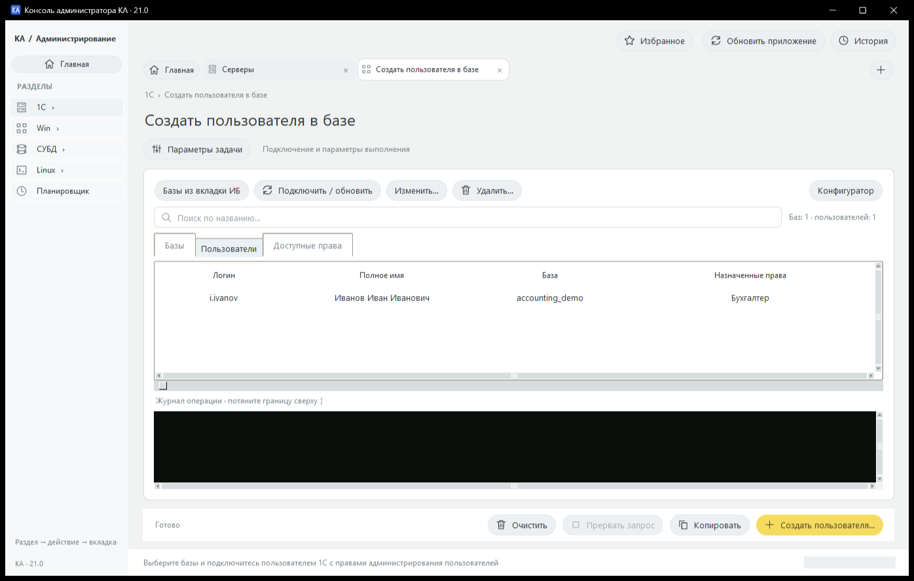

# Консоль администратора КА

**1С · PostgreSQL · Microsoft SQL Server · Windows · Linux**

Администрирование серверов и баз данных из одного приложения для Windows.

[Все версии и изменения](https://github.com/dsn4ik74-alt/KA-Admin-Console/releases)

*Демонстрационные данные.*

## Начать работу

1. Скачайте **ZIP** по кнопке выше и распакуйте EXE — устанавливать Python не требуется.
2. Запустите EXE и подтвердите запрос прав администратора.
3. Выберите раздел и укажите параметры подключения к вашему серверу.

## Возможности

| Раздел | Что можно сделать |
| --- | --- |
| **1С** | Найти и открыть базу, управлять пользователями, добавить базу в кластер, опубликовать на IIS/Apache, установить платформу и конфигурации из ИТС, архивировать ЖР, проверить программные лицензии через ring. |
| **СУБД** | Создать или удалить базу, выполнить бэкап, восстановление или цепочку «бэкап + восстановление» для MSSQL и PostgreSQL. |
| **Windows / Linux** | Управлять службами Windows, создавать локальные учётные записи, анализировать диски и передавать файлы через Robocopy, SMB и SFTP. |
| **Планировщик** | Запускать последовательности действий по расписанию и просматривать журналы. |

Есть избранные подключения, параллельные задачи, история операций и сохранённые логи.
Для ИТС нужна ваша учётная запись с доступом к выбранному дистрибутиву; для серверных операций — соответствующие права.

## Что изменилось

**21.9**

- Добавлена «СУБД → PostgreSQL → Консоль PostgreSQL»: выбор сервера, базы и пользователя, редактор SQL, таблицы результатов, копирование и прерывание запросов.
- Каждая консоль поддерживает независимый сеанс и явные транзакции `BEGIN / COMMIT / ROLLBACK`. F5 или Ctrl+Enter выполняют выделенный фрагмент либо весь текст; другие вкладки доступны во время запроса.
- При создании службы 1С доступен флажок отладки: `-debug` добавляется в конец параметров агента или удаляется, включая вручную отредактированные команды.
- При отказе аутентификации кластера видно, передавались ли логин и пароль. Значения паролей не выводятся; лишние попытки изменения ИБ не выполняются.

SQL-консоль подключается по TCP с компьютера приложения к PostgreSQL на Windows или Linux. Драйвер встроен в EXE. Запросы выполняются с правами выбранного пользователя; текст SQL не сохраняется в истории операций.

**Переход с 20.33.x:** один раз скачайте ZIP и замените EXE. Для 21.x доступно обновление через приложение.

**Переход с 21.4 и ниже:** закройте все экземпляры КА, скачайте актуальный ZIP через браузер и распакуйте EXE в новую папку. Это нужно, чтобы заменить старый обработчик обновления, который мог не запускать приложение после замены. Настройки хранятся отдельно.

[Предыдущие версии и полный список изменений](https://github.com/dsn4ik74-alt/KA-Admin-Console/releases)

---

Нашли проблему? [Создайте обращение](https://github.com/dsn4ik74-alt/KA-Admin-Console/issues) и приложите версию приложения и текст ошибки без паролей.

В этом репозитории публикуются готовые версии и файлы обновления приложения.
