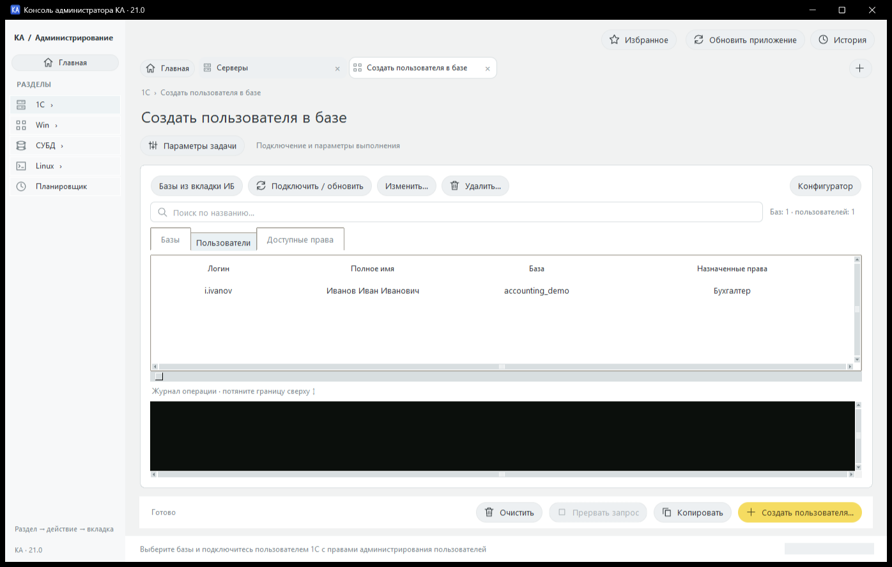

# Консоль администратора КА

**1С · PostgreSQL · Microsoft SQL Server · Windows · Linux**

Администрирование серверов и баз данных из одного приложения для Windows.

[Все версии и изменения](https://github.com/dsn4ik74-alt/KA-Admin-Console/releases)

*Демонстрационные данные.*

## Начать работу

1. Скачайте **ZIP** по кнопке выше и распакуйте EXE — устанавливать Python не требуется.
2. Запустите EXE и подтвердите запрос прав администратора.
3. Выберите раздел и укажите параметры подключения к вашему серверу.

## Возможности

| Раздел | Что можно сделать |
| --- | --- |
| **1С** | Найти и открыть базу, управлять пользователями, добавить базу в кластер, опубликовать на IIS/Apache, установить платформу и конфигурации из ИТС, архивировать ЖР, проверить программные лицензии через ring. |
| **СУБД** | Создать или удалить базу, выполнить бэкап, восстановление или цепочку «бэкап + восстановление» для MSSQL и PostgreSQL. |
| **Windows / Linux** | Управлять службами Windows, создавать локальные учётные записи, анализировать диски и передавать файлы через Robocopy, SMB и SFTP. |
| **Планировщик** | Запускать последовательности действий по расписанию и просматривать журналы. |

Есть избранные подключения, параллельные задачи, история операций и сохранённые логи.
Для ИТС нужна ваша учётная запись с доступом к выбранному дистрибутиву; для серверных операций — соответствующие права.

## Что изменилось

**21.2**

- Вкладка создания пользователей автоматически показывает общий список ИБ и умеет обновлять его самостоятельно. Исправлена потеря баз без версии платформы.
- XML публикаций отображается с отступами и переносами атрибутов. Добавлена кнопка форматирования; изменения WS/HS сохраняются в читаемом виде.
- Сохранены управление пользователями и правами, публикациями IIS/Apache, поиск с масками и список служб.

**Переход с 20.33.x:** один раз скачайте ZIP и замените EXE. Для 21.x доступно обновление через приложение.

[Предыдущие версии и полный список изменений](https://github.com/dsn4ik74-alt/KA-Admin-Console/releases)

---

Нашли проблему? [Создайте обращение](https://github.com/dsn4ik74-alt/KA-Admin-Console/issues) и приложите версию приложения и текст ошибки без паролей.

Исходники находятся в **src**, готовый комплект со встроенными утилитами — в **Releases**. Запуск исходников: `python "src/1C Console.py"`; для сборки из исходников сторонние утилиты нужно подготовить отдельно.
