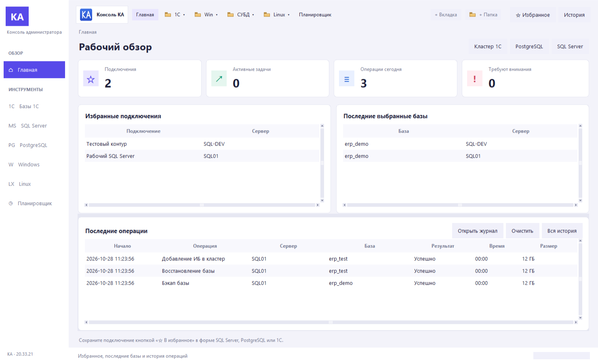
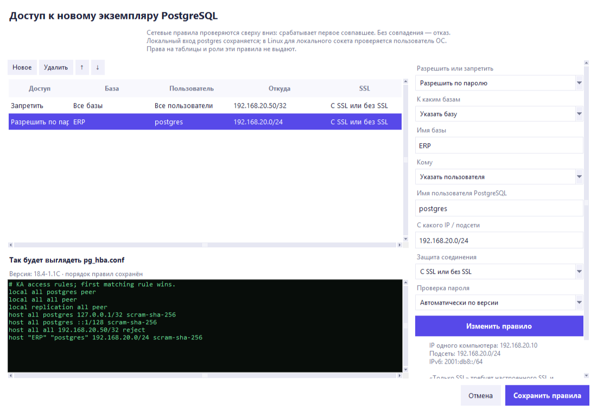

# Консоль администратора КА

**1С · PostgreSQL · Microsoft SQL Server · Windows · Linux**

Администрирование серверов и баз данных из одного приложения для Windows.

[Все версии и изменения](https://github.com/dsn4ik74-alt/KA-Admin-Console/releases)

*Версия 20.33.23: публикация ИБ, демонстрационные данные.*

## Начать работу

1. Скачайте **EXE** по кнопке выше — устанавливать Python не требуется.
2. Запустите приложение и подтвердите запрос прав администратора.
3. Выберите раздел и укажите параметры подключения к вашему серверу.

## Возможности

| Раздел | Что можно сделать |
| --- | --- |
| **1С** | Найти и открыть базу, добавить её в кластер, опубликовать на IIS/Apache, установить платформу и типовые конфигурации из ИТС, архивировать ЖР. |
| **СУБД** | Создать или удалить базу, выполнить бэкап, восстановление или цепочку «бэкап + восстановление» для MSSQL и PostgreSQL. |
| **Windows / Linux** | Управлять службами Windows, создавать локальные учётные записи, анализировать диски и передавать файлы через Robocopy, SMB и SFTP. |
| **Планировщик** | Запускать последовательности действий по расписанию и просматривать журналы. |

Есть избранные подключения, параллельные задачи, история операций и сохранённые логи.
Для ИТС нужна ваша учётная запись с доступом к выбранному дистрибутиву; для серверных операций — соответствующие права.

## Что изменилось

**20.33.24** — кнопка **«Проверить SSH»** отдельно у источника и получателя передачи файлов. Успешное подключение сохраняется в списке Linux-серверов. Перед установкой PostgreSQL можно настроить `pg_hba.conf` понятными правилами: базы, пользователи, IP/подсети, разрешения и запреты, порядок проверки и SSL; рядом виден итоговый файл.

**20.33.23** — публикация ИБ на IIS/Apache, управление сайтами, пулами и привязками IIS, редактор конфигураций с резервными копиями. Передача файлов Windows ↔ Windows, Windows ↔ Linux и Linux ↔ Linux; инструкции по включению WinRM, SMB и SSH. Исправлен поиск библиотек PostgreSQL при установке бинарного комплекта Linux в выбранную папку; добавлены проверка запуска утилит и повторное использование совпадающего комплекта после сбоя.

**20.33.22** — разделы и вложенные вкладки перенесены в компактную боковую панель: раскрытие при наведении, перетаскивание, добавление своих разделов и вкладок.

**20.33.21** — светлый интерфейс, карточки главной, фиолетовые акценты и обновлённые таблицы и формы.

Настройка доступа PostgreSQL перед установкой

---

Нашли проблему? [Создайте обращение](https://github.com/dsn4ik74-alt/KA-Admin-Console/issues) и приложите версию приложения и текст ошибки без паролей.

В репозитории — исходники приложения. Готовый комплект со встроенными утилитами находится в **Releases**; для сборки из исходников сторонние утилиты нужно подготовить отдельно.
